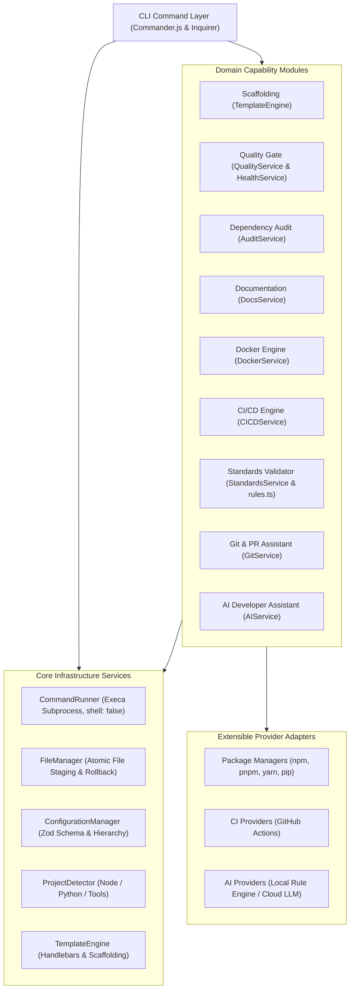

# DevFlow

> **Build smarter. Standardize everything. Ship with confidence.**

DevFlow is an extensible, production-oriented developer productivity, workflow automation, and Developer Experience (DevEx) CLI platform. Built for modern software engineering teams, DevFlow standardizes project creation, automates engineering quality checks, audits dependency security with lockfile awareness, generates hardened CI/CD pipelines, diagnoses development environments, and helps teams ship software safely.

[](LICENSE)
[](https://nodejs.org)
[](https://www.typescriptlang.org/)
[](tests/)

---

## Table of Contents

- [Problem Statement](#problem-statement)
- [Key Features](#key-features)
- [Architecture Overview](#architecture-overview)
- [Prerequisites](#prerequisites)
- [Installation from GitHub](#installation-from-github)
- [Build and Local Setup](#build-and-local-setup)
- [Supported Project Templates](#supported-project-templates)
- [Complete Command Reference](#complete-command-reference)
  - [Project Management](#project-management)
  - [Development Automation](#development-automation)
  - [Infrastructure](#infrastructure)
  - [Developer Experience](#developer-experience)
  - [System & Health](#system--health)
- [Practical Usage Examples & Terminal Output](#practical-usage-examples--terminal-output)
- [Configuration Reference (`.devflowrc.json`)](#configuration-reference-devflowrcjson)
- [Docker & CI/CD Requirements](#docker--cicd-requirements)
- [Known Limitations](#known-limitations)
- [Troubleshooting](#troubleshooting)
- [Testing & Development](#testing--development)
- [Contributing](#contributing)
- [License](#license)

---

## Problem Statement

Modern software engineering teams spend significant hours re-inventing standard configurations:
1. **Inconsistent Project Setup:** Every developer configures linting, TypeScript, testing, Docker, and CI differently.
2. **Fragmented Quality Gates:** Verification steps (formatting, types, tests, security) are often run ad-hoc or skipped until remote CI pipelines fail.
3. **Deceptive Dependency Audits:** Raw package manager audits (such as `npm audit`) often yield confusing remediation guidance—suggesting updates for top-level packages that developers misinterpret as fixes for nested transitive dependencies.
4. **Environment Discrepancies:** "Works on my machine" issues persist due to unvalidated system runtimes and missing environment configurations.
5. **Organizational Drift:** Engineering standards decay over time because repositories cannot be easily validated against policy.

**DevFlow eliminates this friction** by providing a single, unified Developer Experience CLI that standardizes setup, automates quality verification, and diagnoses environments.

---

## Key Features

- **Extensible Scaffolding Engine:** Battle-tested project templates for TypeScript Express REST APIs, Python FastAPI microservices, and Node.js CLI tools.
- **Unified Quality Gate (`devflow check`):** Sequentially runs linting, formatting checks, type checking, test suites, security audits, environment verification, and Git hygiene.
- **Lockfile-Aware Dependency Security Analyzer (`devflow audit`):** Analyzes npm and Python dependencies, inspects lockfiles to resolve actual installed versions of nested packages, avoids version inversion, enforces severity fail policies, and supports safe remediation (`--fix`).
- **Environment Diagnostics (`devflow doctor`):** Project-aware diagnostic engine that verifies OS, Node, npm, Python, Git, Docker CLI/daemon, environment files, and local dependencies.
- **Organizational Standards Validator (`devflow standards`):** Define repo standards in `.devflowrc.json` and validate compliance across teams using an extensible Strategy-pattern rule engine.
- **Hardened CI/CD Pipeline Generator (`devflow ci`):** Generates GitHub Actions workflows with least-privilege permissions, dependency caching, timeouts, and SHA pinning in strict mode.
- **Docker Automation (`devflow docker`):** Multi-stage build Dockerfiles and Docker Compose files with health checks, persistent volumes, and non-root users.
- **Boundary-Guarded Documentation Generator (`devflow docs`):** Generates and maintains comprehensive `README.md` documentation while protecting user-maintained custom sections using HTML comment markers.
- **Git & PR Assistant (`devflow pr`):** Analyzes changed files, lines, sensitive configurations, missing test coverage, and generates structured PR summaries.
- **Privacy-Preserving AI Assistant (`devflow ai`):** Offline-first assistant explaining build/check failures and project architecture using a deterministic local knowledge engine (zero network requests) with opt-in cloud LLM support.

---

## Architecture Overview

DevFlow follows a modular, layered architecture separating the CLI transport layer from core infrastructure, business domain modules, and providers:



---

## Prerequisites

- **Node.js:** `>= 18.0.0` (LTS Node.js 20 or 22 recommended)
- **npm:** `>= 9.0.0`
- **Git:** Installed and available in your system `PATH`
- **Python:** `>= 3.10` (Optional; required only for Python FastAPI templates)
- **Docker:** Optional; required for Docker container runtime execution and builds

---

## Installation from GitHub

Clone the repository directly from GitHub:

```bash
# Clone the repository
git clone https://github.com/yashwant-gh/devflow.git
cd devflow
```

---

## Build and Local Setup

Follow these steps to install dependencies, build the project, and link the CLI:

```bash
# 1. Install dependencies
npm install

# 2. Build TypeScript source and copy bundled templates
npm run build

# 3. Link the CLI globally for local development
npm link

# 4. Verify that the CLI is accessible
devflow --version
devflow --help
```

### Running Locally Without Global Linking

If you prefer not to link globally, you can invoke the compiled binary directly:

```bash
# Via Node.js directly
node dist/cli/index.js --help

# Via npm start script
npm start -- --help

# Or run the development TypeScript entry point via tsx
npm run dev -- --help
```

### Unlinking Local Global Installation

To remove the global symlink:

```bash
npm unlink -g devflow-cli
```

---

## Supported Project Templates

DevFlow includes three parameterizable templates:

| Template ID | Name | Ecosystem | Highlights |
|---|---|---|---|
| `node-express-api` | Express.js REST API | TypeScript / Node.js | Strict TypeScript, Express, Zod env validation, error middleware, health endpoints, Vitest unit & integration tests, multi-stage Dockerfile, and GitHub Actions CI. |
| `python-fastapi` | Python FastAPI Service | Python 3.10+ | FastAPI, Pydantic settings, structured logging, pytest suite, Dockerfile, and docker-compose. |
| `node-cli` | Node.js CLI Tool | TypeScript / Node.js | Commander.js, argument parsing, unit tests, tsconfig strict mode, and automated build scripts. |

---

## Complete Command Reference

### Global Options

All DevFlow commands support the following options:

| Flag | Description |
|---|---|
| `-h, --help` | Display command help and usage instructions |
| `-v, --version` | Display the current DevFlow version |
| `--verbose` | Output detailed debugging and process execution timing |
| `--quiet` | Suppress non-essential logs and decorative terminal banners |
| `--json` | Output machine-readable JSON for CI/CD automation |
| `--no-interactive` | Disable interactive prompts for automated scripting |
| `-y, --yes` | Automatically answer yes to confirmation prompts |
| `--dry-run` | Simulate actions and report planned file operations without changes |
| `--cwd <path>` | Execute the command against an explicit working directory |

---

### Project Management

#### `devflow init [name]`
Scaffolds a new standardized project from a template.
```bash
# Interactive mode
devflow init

# Non-interactive mode
devflow init payment-service --template node-express-api --no-interactive

# Flags:
#   -t, --template <id>          Template ID (node-express-api, python-fastapi, node-cli)
#   --desc <description>         Project description
#   --pm <manager>               Package manager (npm, pnpm, yarn, pip)
#   --no-testing                 Exclude automated testing configuration
#   --no-linting                 Exclude linting and formatting configuration
#   --no-docker                  Exclude Docker configuration
#   --no-compose                 Exclude Docker Compose configuration
#   --no-ci                      Exclude CI/CD pipeline configuration
#   --no-git                     Skip Git repository initialization
#   --install                    Install dependencies after generation
#   --force                      Overwrite existing files in target directory
```

#### `devflow templates`
Lists all available project scaffolding templates, supported languages, categories, and tags.
```bash
devflow templates
```

---

### Development Automation

#### `devflow check`
Executes unified engineering quality gate checks sequentially.
```bash
# Run all quality checks
devflow check

# Run specific checks only
devflow check --only lint,test

# Skip specific checks
devflow check --skip audit

# Output JSON report for CI pipelines
devflow check --json
```

#### `devflow audit`
Analyzes project dependencies for known CVE vulnerabilities and outdated packages.
```bash
# Audit dependencies
devflow audit

# Enforce severity threshold (low, moderate, high, critical)
devflow audit --severity high

# Automatically fix compatible vulnerabilities safely (npm audit fix)
devflow audit --fix
```

#### `devflow test [args...]`
Executes automated test suites using the detected project runner (`vitest` or `pytest`), forwarding additional arguments.
```bash
devflow test
devflow test -- --coverage
```

#### `devflow lint [args...]`
Executes code linting and static analysis using the detected configuration (`eslint` or `ruff`), forwarding arguments.
```bash
devflow lint
devflow lint -- --fix
```

#### `devflow add <feature>`
Adds standardized configurations to an existing project: `testing`, `linting`, `formatting`, `docker`.
```bash
devflow add testing
devflow add linting
devflow add formatting
devflow add docker --postgres --redis
```

---

### Infrastructure

#### `devflow docker validate`, `init`, `build`
Manages, generates, validates, and builds Docker container configurations.
```bash
# Validate Dockerfile instructions, Compose YAML syntax, and Docker daemon status
devflow docker validate

# Generate Dockerfile and Compose for an existing project
devflow docker init --port 3000 --postgres --redis

# Build container image (requires running Docker daemon)
devflow docker build payment-service:latest
```

#### `devflow ci init`, `validate`, `update`
Manages GitHub Actions CI/CD workflows.
```bash
# Generate a GitHub Actions workflow with standard profile
devflow ci init --profile standard

# Generate with strict profile (pinned commit SHAs, strict timeouts)
devflow ci init --profile strict

# Validate existing workflow YAML structure and security attributes
devflow ci validate

# Safely update existing workflow to match latest profile settings
devflow ci update --profile strict
```

---

### Developer Experience

#### `devflow doctor`
Diagnoses host system runtimes, developer tools, project dependencies, and environment status.
```bash
devflow doctor
devflow doctor --json
```

#### `devflow docs generate`
Generates and maintains standardized `README.md` documentation while protecting user-maintained custom sections.
```bash
devflow docs generate
devflow docs generate --force
```

#### `devflow standards check`, `init`, `explain`
Validates repository compliance against organizational rules defined in `.devflowrc.json`.
```bash
# Check compliance against organizational standards
devflow standards check

# Generate default standards configuration
devflow standards init

# Explain a specific rule and remediation instructions
devflow standards explain require-readme
```

#### `devflow pr analyze`, `summary`
Analyzes Git changes, identifies sensitive file modifications, detects missing test coverage, and generates formatted PR summaries.
```bash
devflow pr analyze
devflow pr summary
devflow pr summary --output pr-description.md
```

#### `devflow ai explain`, `explain-project`
Provides contextual explanation of check failures and project architecture using an offline-first privacy model.
```bash
# Offline failure explanation (pattern-matches compiler/test errors)
devflow ai explain "error TS2322: Type 'string' is not assignable to type 'number'"

# Summarize project architecture (offline file inspection)
devflow ai explain-project

# Optional cloud LLM completion (requires explicit consent and DEVFLOW_AI_API_KEY)
devflow ai explain "complex failure log" --consent
```

---

### System & Health

#### `devflow health`
Computes an overarching engineering health score (0-100%) and letter grade across Quality, Security, and Standards.
```bash
devflow health
```

#### `devflow config show`, `validate`, `set`
Inspects, validates, and modifies DevFlow configuration hierarchy.
```bash
devflow config show
devflow config validate
devflow config set security.failOn "[\"high\",\"critical\"]"
```

---

## Practical Usage Examples & Terminal Output

### Example 1: Environment Diagnostics (`devflow doctor`)

```bash
$ devflow doctor
```
```text
┌───────────────────┬──────────┬───────────┬────────────────────────────────────────┐
│ Component         │ Category │ Status    │ Details                                │
├───────────────────┼──────────┼───────────┼────────────────────────────────────────┤
│ Operating System  │ SYSTEM   │ Installed │ Windows_NT (win32)                     │
│ Architecture      │ SYSTEM   │ Installed │ x64                                    │
│ Node.js           │ TOOLS    │ Installed │ v22.5.5                                │
│ npm               │ TOOLS    │ Installed │ 10.8.2                                 │
│ Git               │ TOOLS    │ Installed │ 2.43.0                                 │
│ Python            │ TOOLS    │ Installed │ 3.11.4                                 │
│ Docker CLI        │ TOOLS    │ Installed │ 27.0.3                                 │
│ Docker Daemon     │ TOOLS    │ Active    │ 27.0.3                                 │
│ Dependencies      │ PROJECT  │ Installed │ node_modules present                   │
│ Environment File  │ PROJECT  │ Present   │ .env present                           │
└───────────────────┴──────────┴───────────┴────────────────────────────────────────┘
✔ Developer environment is ready for development.
```

### Example 2: Dependency Security Audit (`devflow audit`)

```bash
$ devflow audit --severity high
```
```text
┌──────────────┬──────────┬───────────┬───────────┬────────────────────────────────────────────────────────┐
│ Package      │ Severity │ Installed │ Fixed In  │ Remediation                                            │
├──────────────┼──────────┼───────────┼───────────┼────────────────────────────────────────────────────────┤
│ cross-spawn  │ HIGH     │ 7.0.3     │ 7.0.6     │ Update cross-spawn to 7.0.6                            │
└──────────────┴──────────┴───────────┴───────────┴────────────────────────────────────────────────────────┘
✖ Policy violation: Detected 1 vulnerabilities meeting or exceeding fail policy [high, critical].
```

---

## Configuration Reference (`.devflowrc.json`)

Repositories can define project settings in `.devflowrc.json`:

```json
{
  "version": 1,
  "project": {
    "name": "payment-service",
    "type": "node-api"
  },
  "standards": {
    "requireReadme": true,
    "requireTests": true,
    "requireDocker": true,
    "requireCICD": true,
    "requireEnvExample": true,
    "requireGitignore": true,
    "requireTypeChecking": true
  },
  "quality": {
    "minimumCoverage": 70,
    "failOnLintError": true,
    "failOnTypeError": true
  },
  "security": {
    "failOn": ["high", "critical"],
    "autoFix": false
  },
  "ci": {
    "provider": "github-actions",
    "profile": "standard"
  }
}
```

Configuration resolution precedence:
1. Command-line flags (e.g. `--severity high`, `--force`)
2. Repository `.devflowrc.json`
3. User home directory configuration `~/.devflowrc.json`
4. Built-in defaults

---

## Docker & CI/CD Requirements

### Docker Requirements
- `devflow docker validate` performs static validation on `Dockerfile` and `docker-compose.yml` even if the Docker daemon is offline.
- To execute container builds (`devflow docker build`), Docker Desktop or the Linux Docker daemon (`dockerd`) must be running with the Docker socket accessible.

### CI/CD Requirements
- DevFlow generates workflows for **GitHub Actions** (`.github/workflows/ci.yml`).
- Generated workflows require a standard GitHub Actions runner (`ubuntu-latest`) with `actions/checkout` and appropriate Node.js/Python setup actions.

---

## Known Limitations

To maintain engineering transparency, the following technical boundaries should be noted:
1. **CI/CD Provider Support:** DevFlow currently implements workflow generation exclusively for **GitHub Actions**. GitLab CI generation is not currently implemented.
2. **Dockerfile Validation:** `DockerService.validate()` performs text/instruction checking (`FROM`, `USER`) and YAML parsing for Compose files; it does not perform full AST parsing of Dockerfiles.
3. **Rollback Scope:** `FileManager.rollback()` removes *newly created files* when scaffolding fails. It does not back up or restore pre-existing files that were overwritten.
4. **Path Boundary Containment:** `resolveSafePath()` performs lexical string containment checking (`path.relative`). It does not resolve symbolic links (`fs.realpath`).
5. **Subprocess Cleanup:** `CommandRunner` sets `cleanup: true`, which terminates direct child processes on parent exit. Detached background grandchild processes or daemons are not terminated.
6. **Live Security Audits:** `devflow audit` requires outbound HTTPS network access to `registry.npmjs.org` and an existing `package-lock.json`. It cannot verify dependency vulnerabilities offline.

---

## Troubleshooting

### 1. `Docker daemon is stopped` or `daemon_stopped` warning
- **Cause:** The Docker CLI binary is found on your `PATH`, but Docker Desktop or the background `dockerd` service is not running.
- **Solution:** Start Docker Desktop (on macOS/Windows) or run `sudo systemctl start docker` (on Linux), then re-run `devflow doctor`.

### 2. `No lockfile found (package-lock.json)` during `devflow audit`
- **Cause:** `npm audit` requires a package lockfile to construct the dependency graph.
- **Solution:** Run `npm install` to generate `package-lock.json` before running `devflow audit`.

### 3. `devflow: command not found` after `npm link`
- **Cause:** Your global npm binary directory is not included in your operating system's `PATH`.
- **Solution:** Verify your npm prefix with `npm prefix -g` and ensure the `bin` directory (or npm directory on Windows) is in your system `PATH`. Alternatively, run `node dist/cli/index.js`.

### 4. `Access denied: Path ... traverses outside base directory`
- **Cause:** A path argument passed to the CLI or template engine contains `../` sequences that resolve outside the project boundary.
- **Solution:** Ensure target paths remain within the intended workspace folder.

---

## Testing & Development

DevFlow includes a comprehensive automated test suite built with Vitest:

```bash
# Run all 98 tests across 19 suites
npm test

# Run tests in watch mode during development
npm run test:watch

# Run tests with v8 code coverage
npm run test:coverage

# Run TypeScript type check
npm run typecheck

# Check and fix linting
npm run lint
npm run lint:fix

# Check and fix formatting
npm run format:check
npm run format
```

---

## Contributing

We welcome contributions from the community. Please review [CONTRIBUTING.md](CONTRIBUTING.md) and our [Code of Conduct](CODE_OF_CONDUCT.md) for architectural guidelines, branch conventions, and testing requirements.

For security vulnerability disclosures, please review [SECURITY.md](SECURITY.md).

---

## License

This project is licensed under the MIT License - see the [LICENSE](LICENSE) file for details.
