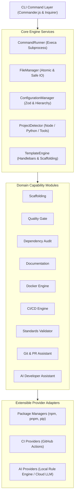

# DevFlow

> **Build smarter. Standardize everything. Ship with confidence.**

DevFlow is an extensible, production-oriented developer productivity, workflow automation, and Developer Experience (DevEx) CLI platform. Built for modern software engineering teams, DevFlow standardizes project creation, automates engineering quality checks, audits dependency security, generates hardened CI/CD pipelines, diagnoses development environments, and helps teams ship software safely.

---

## Table of Contents

- [Problem Statement](#problem-statement)
- [Key Features](#key-features)
- [Architecture Overview](#architecture-overview)
- [Requirements](#requirements)
- [Installation & Quick Start](#installation--quick-start)
- [Supported Templates](#supported-templates)
- [Command Reference](#command-reference)
  - [Project Management](#project-management)
  - [Development Automation](#development-automation)
  - [Infrastructure](#infrastructure)
  - [Developer Experience](#developer-experience)
  - [System & Health](#system--health)
- [Configuration Reference](#configuration-reference)
- [Engineering Standards Rule Engine](#engineering-standards-rule-engine)
- [Security & Trust Model](#security--trust-model)
- [Docker & Containerization](#docker--containerization)
- [CI/CD Automation](#cicd-automation)
- [Testing](#testing)
- [Contributing](#contributing)
- [License](#license)

---

## Problem Statement

Modern software teams spend significant engineering hours re-inventing standard configurations:
1. **Inconsistent Project Setup:** Every developer configures linting, TypeScript, testing, Docker, and CI differently.
2. **Fragmented Quality Gates:** Verification steps (formatting, types, tests, security) are often run ad-hoc or skipped until remote CI fails.
3. **Hidden Vulnerabilities:** Security audits are infrequently run locally and advisory reports lack clear remediation paths.
4. **Environment Discrepancies:** "Works on my machine" issues persist due to unvalidated system runtimes and missing environment files.
5. **Organizational Drift:** Engineering standards decay over time because repositories cannot be easily validated against policy.

**DevFlow eliminates this friction** by providing a single, unified Developer Experience CLI that standardizes setup, automates quality verification, and diagnoses environments.

---

## Key Features

- **Extensible Scaffolding Engine:** Battle-tested project templates for TypeScript Express REST APIs, Python FastAPI microservices, and Node.js CLI tools.
- **Unified Quality Gate (`devflow check`):** Concurrently runs linting, formatting checks, type checking, test suites, security audits, environment verification, and Git hygiene.
- **Dependency Health & Security Analyzer (`devflow audit`):** Analyzes npm and Python dependencies, checks CVE advisories, enforces severity fail policies, and provides automated safe remediation (`--fix`).
- **Environment Diagnostics (`devflow doctor`):** Project-aware diagnostic engine that verifies OS, Node, npm, Python, Git, Docker, environment files, and local dependencies.
- **Organizational Standards Validator (`devflow standards`):** Define repo standards in `.devflowrc.json` and validate compliance across teams.
- **CI/CD Pipeline Generator (`devflow ci`):** Generates hardened GitHub Actions workflows with least-privilege permissions, dependency caching, timeouts, and SHA pinning.
- **Docker Automation (`devflow docker`):** Multi-stage Dockerfiles and Docker Compose files with health checks, persistent volumes, and non-root users.
- **Documentation Generator (`devflow docs`):** Generates and maintains comprehensive `README.md` with managed comment boundaries to protect custom documentation.
- **Git & PR Assistant (`devflow pr`):** Analyzes changed files, lines, sensitive configs, missing tests, and generates structured PR summaries.
- **Privacy-Preserving AI Assistant (`devflow ai`):** Optional offline-first assistant explaining build/check failures and architecture without leaking source code.

---

## Architecture Overview

DevFlow follows a modular, layered architecture separating the CLI transport layer from business logic and providers.



---

## Requirements

- **Node.js:** `>= 18.0.0` (Recommended: LTS Node.js 20 or 22)
- **npm:** `>= 9.0.0`
- **Git:** Installed and available in PATH (for Git and PR features)
- **Python:** `>= 3.10` (Optional, required for Python project templates)
- **Docker:** Optional (required for Docker runtime execution)

---

## Installation & Quick Start

### Build and Install Locally

```bash
# Clone the repository
git clone https://github.com/devflow-cli/devflow.git
cd devflow

# Install dependencies and build
npm install
npm run build

# Link CLI globally (or run directly via node)
npm link
```

### 5-Minute Quick Start

```bash
# 1. Initialize a new Express.js REST API
devflow init payment-service --template node-express-api --no-interactive

# 2. Enter project directory
cd payment-service

# 3. Diagnose environment readiness
devflow doctor

# 4. Initialize organizational engineering standards
devflow standards init

# 5. Run unified quality gate
devflow check

# 6. Audit dependencies for security vulnerabilities
devflow audit

# 7. Generate or update README documentation
devflow docs generate --force
```

---

## Supported Templates

| Template ID | Name | Ecosystem | Highlights |
|---|---|---|---|
| `node-express-api` | Express.js REST API | TypeScript / Node.js | Strict TypeScript, Express, Zod env validation, centralized error handling, Vitest unit & integration tests, multi-stage Dockerfile, GitHub Actions CI. |
| `python-fastapi` | Python FastAPI Service | Python 3.10+ | FastAPI, Pydantic settings, structured logging, pytest test suite, Dockerfile, docker-compose. |
| `node-cli` | Node.js CLI Tool | TypeScript / Node.js | Commander.js, argument parsing, unit tests, tsconfig strict mode, automated build scripts. |

---

## Command Reference

### Global Options

All DevFlow commands support the following options:

| Flag | Description |
|---|---|
| `-h, --help` | Display command help and usage |
| `-v, --version` | Display current DevFlow version |
| `--verbose` | Output detailed debugging and process execution logs |
| `--quiet` | Suppress non-essential logs and decorative banners |
| `--json` | Output machine-readable JSON for CI/CD automation |
| `--no-interactive` | Disable interactive prompts for script execution |
| `-y, --yes` | Automatically answer yes to confirmation prompts |
| `--dry-run` | Simulate actions and report planned file operations without changes |
| `--cwd <path>` | Execute command against an explicit working directory |

### Exit Code Contract

DevFlow adheres to standard exit codes:

- `0`: Operation succeeded cleanly.
- `1`: General runtime failure or unhandled exception.
- `2`: Invalid CLI arguments or configuration schema violation.
- `3`: Missing required system tool or dependency.
- `4`: Engineering quality check failure.
- `5`: Dependency security audit policy failure.
- `130`: Interrupted by user (SIGINT).

---

### Project Management

#### `devflow init [name]`
Scaffolds a new standardized project.
```bash
# Interactive mode
devflow init

# Non-interactive mode
devflow init order-service --template node-express-api --no-interactive
```

#### `devflow templates`
Lists all available project scaffolding templates and capabilities.
```bash
devflow templates
```

---

### Development Automation

#### `devflow check`
Runs unified engineering quality checks.
```bash
# Run all checks
devflow check

# Run specific checks
devflow check --only lint,test

# Skip security audit check during quick local checks
devflow check --skip audit

# Output JSON report for CI pipelines
devflow check --json
```

#### `devflow audit`
Inspects project dependencies for known CVE vulnerabilities and outdated packages.
```bash
# Audit dependencies
devflow audit

# Fail only on high or critical vulnerabilities
devflow audit --severity high

# Automatically fix compatible vulnerabilities
devflow audit --fix
```

#### `devflow test [args...]`
Executes automated test suites using the detected project test runner (e.g., `vitest` or `pytest`).
```bash
devflow test
```

#### `devflow lint [args...]`
Executes code linter using the detected project configuration (e.g., `eslint` or `ruff`).
```bash
devflow lint
```

#### `devflow add <feature>`
Adds standard tools to an existing project: `testing`, `linting`, `formatting`, `docker`.
```bash
devflow add testing
devflow add linting
devflow add formatting
devflow add docker --postgres --redis
```

---

### Infrastructure

#### `devflow docker validate`, `init`, `build`
Manages, generates, validates, and builds Docker container configurations.
```bash
# Validate Dockerfile and Compose setup, CLI and daemon runtime status
devflow docker validate

# Initialize Dockerfile and Compose for an existing project
devflow docker init --postgres --redis

# Build container image (requires active Docker daemon; never fabricates success)
devflow docker build order-service:latest
```

#### `devflow ci init`
Generates a GitHub Actions workflow.
```bash
# Standard profile (install, lint, typecheck, test, build, audit)
devflow ci init --profile standard

# Strict profile (pinned commit SHAs, strict timeouts, hardened permissions)
devflow ci init --profile strict
```

#### `devflow ci validate`
Validates existing CI/CD YAML configuration.
```bash
devflow ci validate
```

#### `devflow ci update`
Updates CI workflow to match latest profile settings.
```bash
devflow ci update --profile standard
```

---

### Developer Experience

#### `devflow doctor`
Diagnoses host system tools, project dependencies, and environment status.
```bash
devflow doctor
devflow doctor --json
```

#### `devflow docs generate`
Generates and synchronizes `README.md` documentation while protecting user-maintained sections via `<!-- devflow:managed:start -->` markers.
```bash
devflow docs generate
devflow docs generate --force
```

#### `devflow standards check`
Validates repository compliance against organizational rules defined in `.devflowrc.json`.
```bash
devflow standards check
devflow standards explain
```

#### `devflow pr analyze` & `devflow pr summary`
Analyzes Git changes, flags risk factors (sensitive files, missing tests), and generates formatted PR summaries.
```bash
devflow pr analyze
devflow pr summary
```

#### `devflow ai explain` & `devflow ai explain-project`
Offline-first failure explanation and architectural analysis. Works 100% offline via local rule knowledge engine, or connects to optional cloud LLM with explicit `--consent`.
```bash
devflow ai explain "error TS2322: Type string is not assignable to number"
devflow ai explain-project
```

---

### System & Health

#### `devflow health`
Calculates an overarching engineering health score across code quality, security policies, standards compliance, and environment diagnostics.
```bash
devflow health
```

#### `devflow config show`
Displays active configuration hierarchy and resolved parameters.
```bash
devflow config show
devflow config validate
```

---

## Configuration Reference

DevFlow repositories are configured via `.devflowrc.json`:

```json
{
  "version": 1,
  "project": {
    "name": "payment-service",
    "type": "node-api"
  },
  "standards": {
    "requireReadme": true,
    "requireTests": true,
    "requireDocker": true,
    "requireCICD": true,
    "requireEnvExample": true,
    "requireGitignore": true,
    "requireTypeChecking": true
  },
  "quality": {
    "minimumCoverage": 70,
    "failOnLintError": true,
    "failOnTypeError": true
  },
  "security": {
    "failOn": ["high", "critical"],
    "autoFix": false
  },
  "ci": {
    "provider": "github-actions",
    "profile": "standard"
  }
}
```

Configuration resolution precedence:
1. Explicit CLI arguments (`--severity`, `--force`)
2. Repository `.devflowrc.json`
3. User home directory `~/.devflowrc.json`
4. Built-in defaults

---

## Security & Trust Model

DevFlow treats security as a fundamental engineering requirement:
- **No Embedded Credentials:** DevFlow never writes secrets, API keys, or private tokens into generated repositories.
- **Credential Redaction:** Process execution logs and terminal output automatically redact tokens, bearer credentials, and registry keys.
- **Directory Traversal Protection:** The file manager validates all target paths to ensure writes remain strictly bounded within the project root.
- **Safe Subprocess Execution:** Subprocesses execute using argument arrays rather than shell string interpolation, eliminating shell injection vulnerabilities.
- **Privacy-Preserving AI:** AI integration is completely optional. Source code and diffs are never sent to external APIs without explicit user consent (`--yes` or `--consent`).
- **Least-Privilege CI:** Generated GitHub Actions workflows use `permissions: contents: read` by default and avoid overprivileged tokens.

For complete vulnerability reporting and security policies, see [SECURITY.md](file:///d:/devflow/SECURITY.md).

---

## Testing

DevFlow includes unit and end-to-end integration tests using Vitest.

```bash
# Run test suite
npm test

# Run tests in watch mode
npm run test:watch

# Generate coverage report
npm run test:coverage
```

---

## Contributing

We welcome community contributions. Please review [CONTRIBUTING.md](file:///d:/devflow/CONTRIBUTING.md) for architectural guidelines, branch conventions, and testing requirements.

---

## License

This project is licensed under the MIT License - see the [LICENSE](file:///d:/devflow/LICENSE) file for details.
