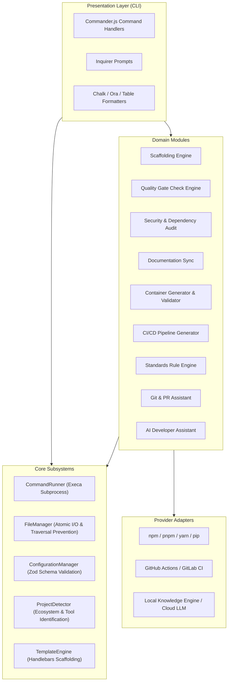

# DevFlow System Architecture

This document describes the architectural design, layer boundaries, and core subsystem mechanics of DevFlow.

---

## 1. Architectural Principles

DevFlow is designed as a modular, extensible, and production-oriented developer operations CLI platform. It follows key software engineering architectural patterns:

- **Separation of Concerns:** The command-line transport layer (`src/cli/`) handles argument parsing, flag evaluation, and user presentation, while delegating all business logic to core services and modules.
- **Dependency Inversion:** High-level workflows depend on abstract interfaces (e.g. `AIProvider`, `StandardRule`) rather than concrete third-party services.
- **Fail-Safe by Default:** Destructive actions (overwriting files, executing dependency fixes, external network transmissions) require explicit user consent or strict confirmation flags.
- **Deterministic and Testable:** Subsystem operations (filesystems, process execution, configuration parsing) are encapsulated in injectable classes enabling thorough unit and integration testing.

---

## 2. Layered Architecture

---

## 3. Subsystem Breakdown

### 3.1 Command Execution Subsystem (`CommandRunner`)
- **Safe Execution:** Wraps `execa` to execute binaries using structured argument arrays (`[file, ...args]`), preventing shell injection vulnerabilities.
- **Output Sanitization:** Automatically masks sensitive strings (Bearer tokens, GitHub personal access tokens, npm tokens, private keys) in `stdout` and `stderr`.
- **Dry-Run Engine:** When `--dry-run` is active, commands log planned executions without spawning child processes.
- **Timeout Management:** Enforces configurable execution timeouts (`DEFAULT_EXEC_TIMEOUT_MS = 120000`) to prevent runaway processes.

### 3.2 Filesystem Subsystem (`FileManager`)
- **Directory Traversal Prevention:** Uses `resolveSafePath()` to guarantee all file operations remain bounded within the target workspace directory.
- **Atomic Writes:** Writes contents to temporary random files (`filename.tmp.<timestamp>.<nonce>`) in the target directory and renames them atomically to prevent partial writes during unexpected terminations.
- **Rollback Tracking:** Maintains an in-memory stack of newly created files during a scaffolding operation; if a subsequent step fails, all generated files are safely rolled back in reverse order.

### 3.3 Configuration Subsystem (`ConfigurationManager`)
- **Zod Schema:** Enforces strict types, defaults, and boundary constraints for `.devflowrc.json`.
- **Precedence Hierarchy:**
  1. Explicit CLI arguments
  2. Project `.devflowrc.json`
  3. User home `~/.devflowrc.json`
  4. Built-in defaults

### 3.4 Scaffolding Engine (`TemplateEngine`)
- **Handlebars Variable Interpolation:** Dynamically compiles templates with project context (project name, description, package manager, year).
- **Conditional Scaffolding:** Omit Docker, CI, or compose files based on CLI flags (`--no-docker`, `--no-ci`).
- **Conflict Detection:** Rejects scaffolding into non-empty directories unless `--force` or `--yes` is supplied.

### 3.5 Standards Rule Engine (`StandardsService`)
- Implements the Strategy / Rule Engine pattern where each engineering policy (e.g. `RequireReadmeRule`, `RequireTestsRule`, `RequireTypeCheckingRule`) is an isolated class implementing `StandardRule`.
- New standards can be registered in the engine without modifying command handlers.
